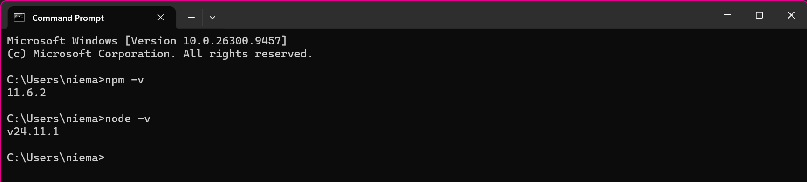
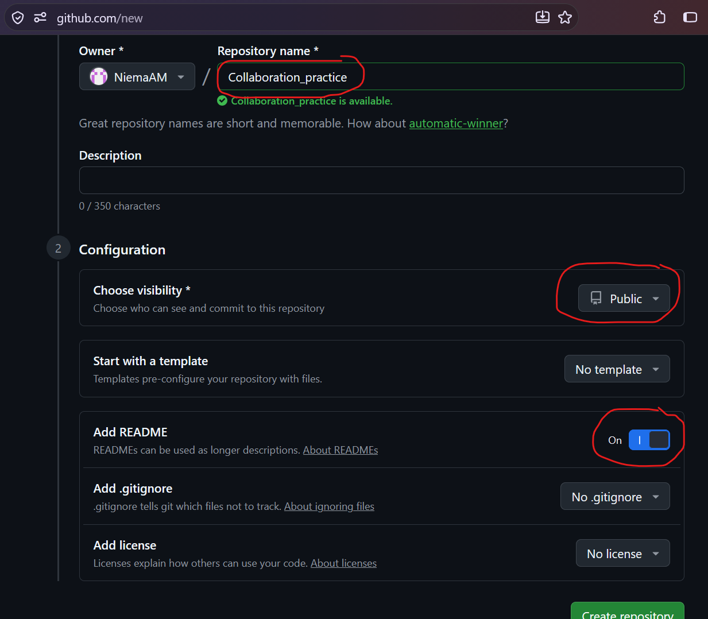
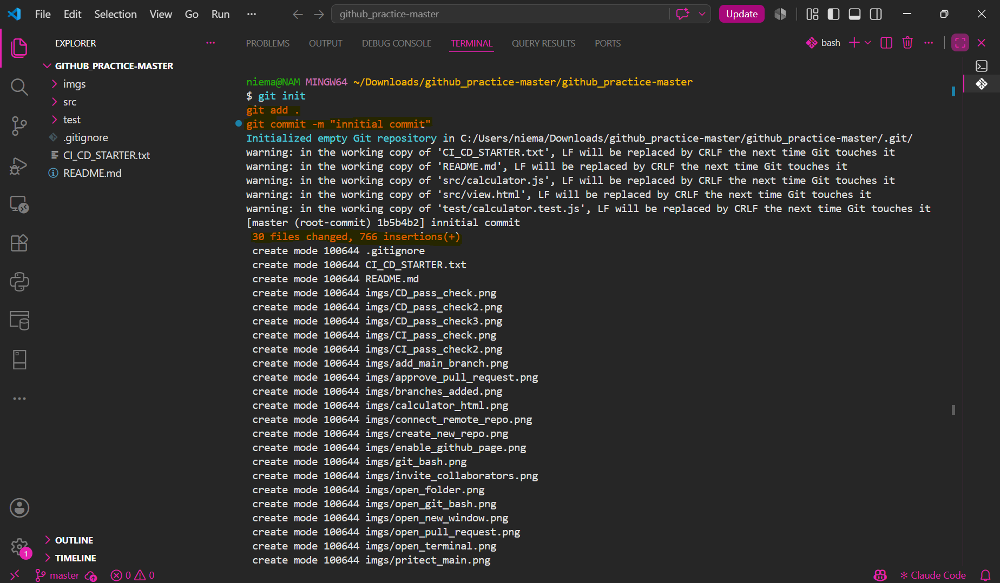

# Practice for Github Session 2

This project is a simple web calculator, use it to practice Github collaboration, testing and actions.

- front-end: [view.html](src/view.html)
- controller: [calculator.js](src/calculator.js)
- unit tests: [claculator.test.js](test/calculator.test.js)
- actions template: [CI_CD_STARTED.txt](CI_CD_STARTED.txt)

# Setup:
## install node.js if not installed yet:
- download from: [nodejs website](https://nodejs.org/)
- verify that it is installed correctly:

> run in your terminal

```bash
node -v
npm -v
```
you should see something like:

KEEP THIS TERMINAL OPEN
MAKE SURE TO NAVIGATE TO YOUR WORKING DIRECTORY USING cd C:/path_to_your_folder_here DURING PRACTICE
YOU WILL BE RUNNING ALL THE npm COMMANDS IN THIS TERMINAL and the git commands in the git bash inside vscode (or terminal in vscode if you have MAC)



# Practice for Github Session 2

This project is a simple web calculator, use it to practice Github collaboration, testing and actions.

- front-end: [view.html](src/view.html)
- controller: [calculator.js](src/calculator.js)
- unit tests: [claculator.test.js](test/calculator.test.js)
- actions template: [CI_CD_STARTED.txt](CI_CD_STARTED.txt)

# Setup:
## install node.js if not installed yet:
- download from: [nodejs website](https://nodejs.org/)
- verify that it is installed correctly:

> run in your terminal

```bash
node -v
npm -v
```
you should see something like:

KEEP THIS TERMINAL OPEN
MAKE SURE TO NAVIGATE TO YOUR WORKING DIRECTORY USING cd C:/path_to_your_folder_here DURING PRACTICE
YOU WILL BE RUNNING ALL THE npm COMMANDS IN THIS TERMINAL and the git commands in the git bash inside vscode (or terminal in vscode if you have MAC)


============================================
============================================

# **WAIT FOR THIS PART**
**PRACTICE 1**

============================================
============================================

# Practice 1: GitHub Collaboration
## Setup:
### 3. create a repote Github repo (Project Manager ONLY!)

got to: Repositories > [new](https://github.com/new) and create a **public** repository.



### 4. create and **innitialize** the local repo (with the same name as the one you created on Github), **add** all the files and commit

> run in git bash

```bash
git init
git add .
git commit -m "innitial commit"
```

> you should see all the commands runing




## Part 1: Add Collaborators

1. **Invite your teammates** as repository collaborators by email (Team of 2 to 3).


ACCEPT THE INVITATION RECEIVED BY EMAIL

2. OPEN A NEW WINDOW IN VSCODE (File>new Window) AND OPEN A FOLDER OF YOUR CHOICE (Open folder) THEN clone the repository by running "git clone" followed by YOUR GITHUB REPO URL in GITBASH (NOT POWERSHELL OR COMMAND PROMPT)

```bash
git clone YOUR_REPO_URL_HERE
```

## Part 2: Protect Main Branch

1. Open your repository's **Settings** → **Rules** → **Rulesets**


3. Create a rule for the **main branch**, make sure to toggle: 
- **Require pull requests** before merging changes.
- **Require approvals** of **1** and passing status checks before merging.

    

## Part 3: Open a Pull Requests

1. Create a **new branch**:
```bash
git checkout -b feature
```
2. Make a **change**: add you name in the README.md file.
3. **Stage** and **commit** your changes:
```bash
   git add .
   git commit -m "added my name"
```
4. **Push** your branch:
```bash
   git push -u origin feature
```
5. Open a **pull request** on GitHub: Describe the change.

 

## Part 4: Review the Pull Request
1. Assign another student to **review your pull request**.
2. **Review** the code changes.


3. Leave a **comment** on the pull request.


4. **Approve** the pull request.


5. **Merge the pull request** after the required checks pass.

## Part 6: Resolve Conflicts
1. Modify the **same line** in separate branches.
2. **Merge the first** branch.
```bash
git checkout main # or master
git pull origin main # or master
git checkout feature/YOUR_NAME_HERE
git merge main # or master
```
3. **Update the second branch** with the latest changes from main.
4. **Resolve the conflict** in your editor.
5. add the changes and **Commit** the resolution.
```bash
git add .
git commit -m "fix: resolve merge conflict"
```