# Practice for Github Session 2

This project is a simple web calculator, use it to practice Github collaboration, testing and actions.

- front-end: [view.html](src/view.html)
- controller: [calculator.js](src/calculator.js)
- unit tests: [claculator.test.js](test/calculator.test.js)
- actions template: [CI_CD_STARTED.txt](CI_CD_STARTED.txt)

# Setup:
## install node.js if not installed yet:
- download from: [nodejs website](https://nodejs.org/)
- verify that it is installed correctly:
```bash
node -v
npm -v
```
you should see something like:
```bash
v24.11.1
```

## 0. Open new window on VsCode then git bash (terminal if on mac or linux)

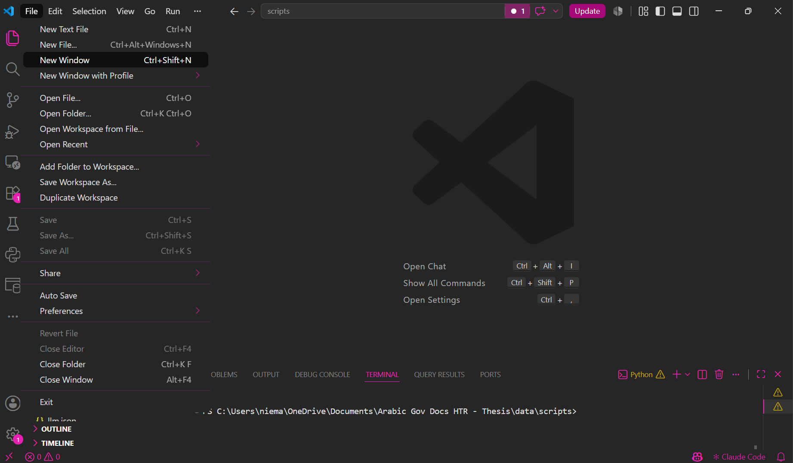 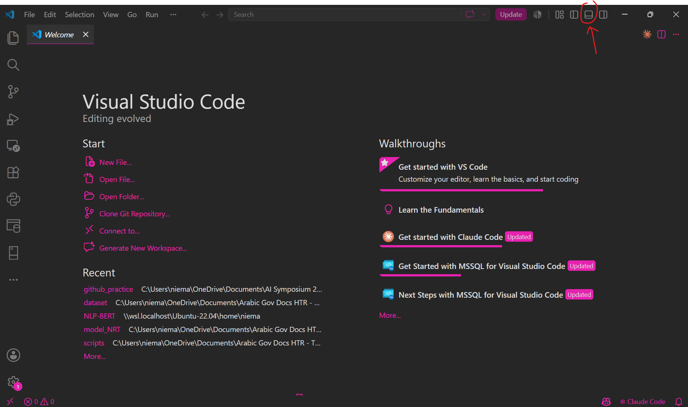 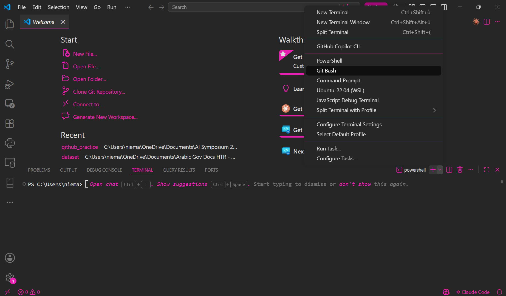 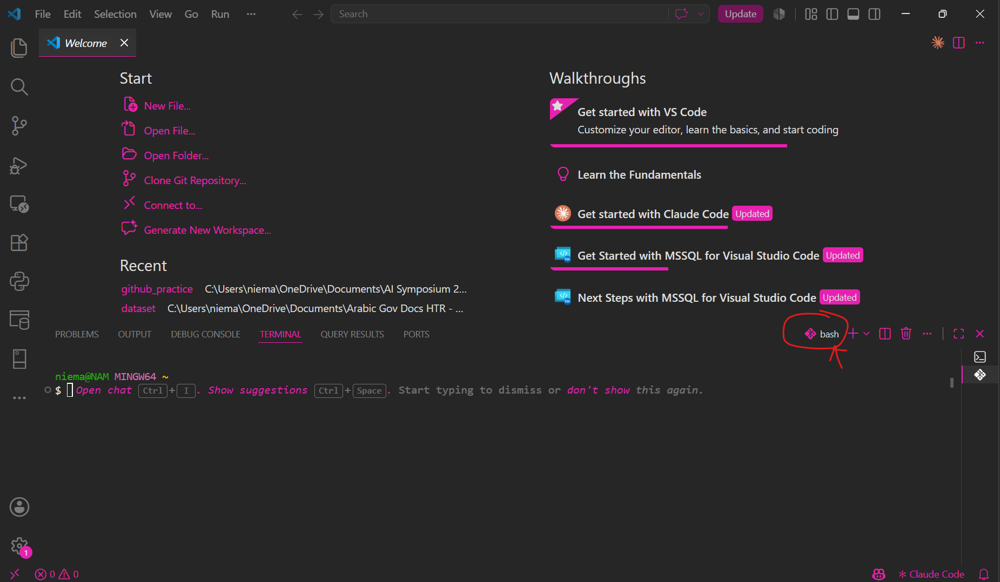  

## 1. create a local repo and innitialize it
```bash
mkdir github_practice
cd github_practice
git init
```

open folder in new window (crtl + click)
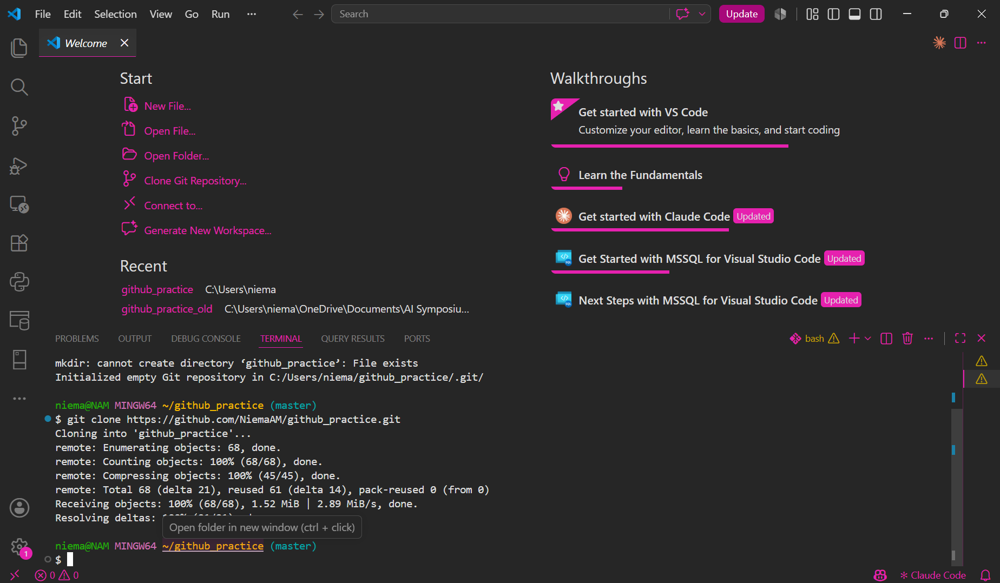

## 3. create a repote Github repo

got to: Repositories > [new](https://github.com/new) and create a **private** repository.


## 4. past the files in this repo to your local repo and add all files
```bash
git add .
```
## 5. commit the added files
```bash
git commit -m "innitial commit"
```
## 6. connect remote repo with local repo

run the commands provided:

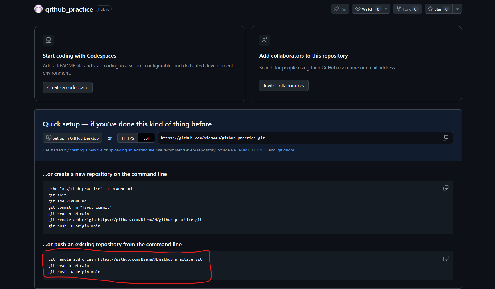

# Practice 1: GitHub Collaboration
## Part 1: Add Collaborators

1. **Invite your teammates** as repository collaborators (Team of 2 to 3).

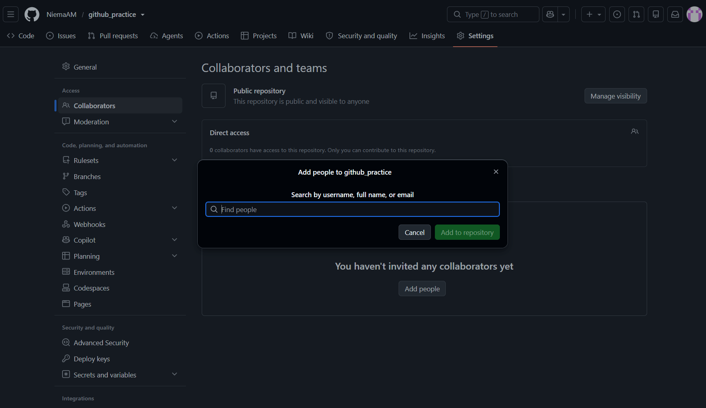

2. Ask each collaborator to **clone the repository**.
```bash
git clone <your repo url>
```

3. **Verify** that everyone can **access** the project.

## Part 2: Protect Main Branch

1. Open your repository's **Settings** → **Rules** → **Rulesets**

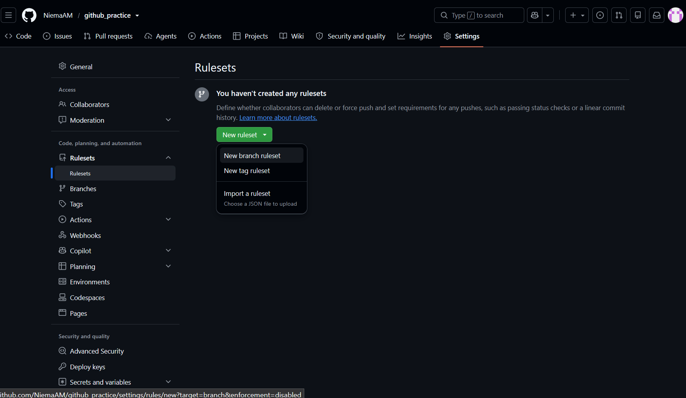

3. Create a rule for the **main branch**: 
- **Require pull requests** before merging changes.
- **Require approvals** and passing status checks before merging.

 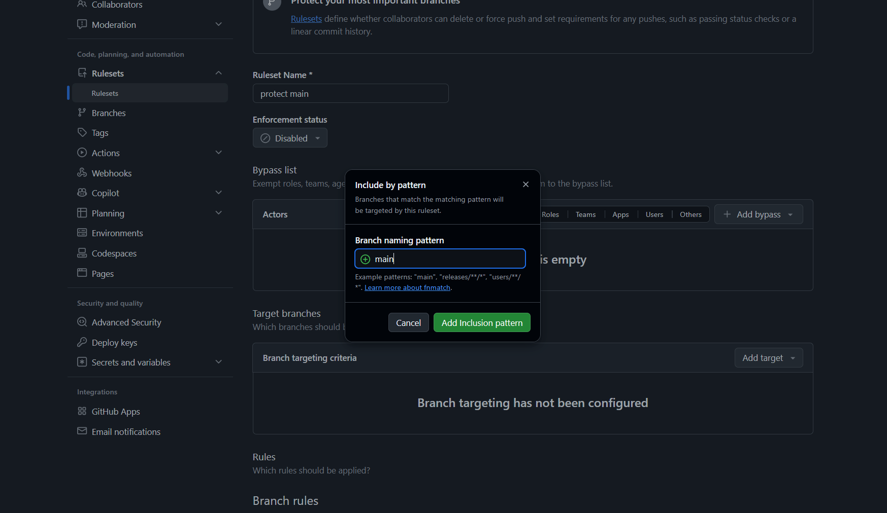   

## Part 3: Open a Pull Requests

1. Create a **new branch**:
```bash
git checkout -b feature
```
2. Make a **change**: add you name in the [view.html](src/view.html) file.
3. **Stage** and **commit** your changes:
```bash
   git add .
   git commit -m "UI: added name to view"
```
4. **Push** your branch:
```bash
   git push -u origin feature
```
5. Open a **pull request** on GitHub: Describe the change and explain how you tested it.

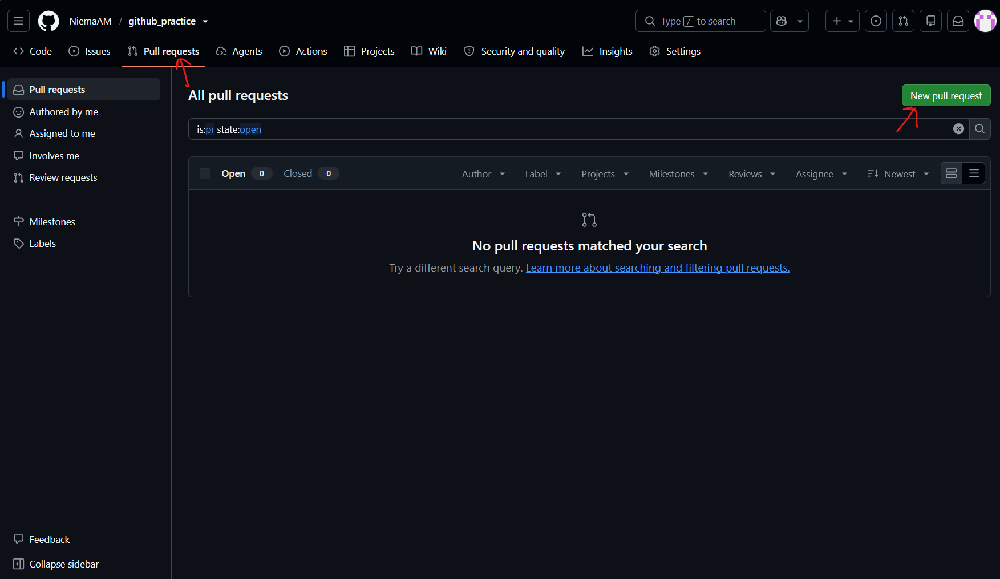 

## Part 4: Review the Pull Request
1. Assign another student to **review your pull request**.
2. **Review** the code changes.


3. Leave a **comment** or suggest an improvement.

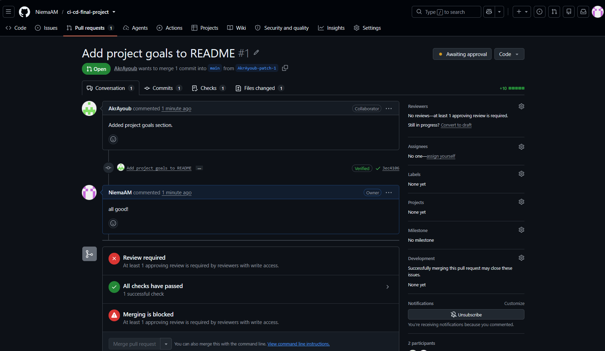

4. **Approve** the pull request.


5. **Merge the pull request** after the required checks pass.

## Part 6: Resolve Conflicts
1. Modify the **same line** in separate branches.
2. **Merge the first** branch.
```bash
git checkout main
git pull origin main
git checkout feature/my-change
git merge main
```
3. **Update the second branch** with the latest changes from main.
4. **Resolve the conflict** in your editor.
5. **Commit** the resolution and complete the pull request.
```bash
git add .
git commit -m "fix: resolve merge conflict"
git push
```

# Practice 2: GitHub Automation
## Part 1: Unit testing
### 1. create a package.json file:

```bash
npm init -y
```

you should see:
```bash
Wrote to github_practice\package.json:

{
  "name": "github_practice",
  "version": "1.0.0",
  "description": "",
  "main": "calculator.js",
  "scripts": {
    "test": "echo \"Error: no test specified\" && exit 1"
  },
  "keywords": [],
  "author": "",
  "license": "ISC",
  "type": "commonjs"
}
```

### 2. Update the package.json file:

change [package.json](package.json) to add **"scripts": {"test": "jest"},**
```bash
{
  "name": "github_practice",
  "version": "1.0.0",
  "description": "",
  "main": "calculator.js",
  "scripts": {
    "test": "jest"
  },
  "keywords": [],
  "author": "",
  "license": "ISC",
  "type": "commonjs"
}
```

### 3. install jest:

```bash
npm install --save-dev jest
```

you should see:
```bash
added 278 packages, and audited 279 packages in 25s
```
and have [package-lock.json](package-lock.json) and [node_modules](node_modules) created on the root, like this:
``` text
github_practice/
├── imgs/
├── node_modules/
├── src/
├── test/
├── .gitignore
├── CI_CD_STARTER.txt
├── package-lock.json
├── package.json
└── README.md
```

### 4. run unit tests:
```bash
npm test
```

you should see:
```bash
> github_practice@1.0.0 test
> jest

 PASS  ./calculator.test.js
  Calculator - Addition
    √ adds two positive numbers (2 ms)
    √ adds a negative number (1 ms)
    √ adds decimal numbers (1 ms)
  Calculator - Subtraction
    √ subtracts two numbers (1 ms)
    √ returns a negative result (1 ms)
  Calculator - Multiplication
    √ multiplies two numbers (1 ms)
    √ multiplying by zero returns zero (1 ms)
    √ multiplies decimal numbers (1 ms)
  Calculator - Division
    √ divides two numbers (1 ms)
    √ divides decimal numbers (1 ms)
    √ throws an error when dividing by zero (5 ms)

Test Suites: 1 passed, 1 total
Tests:       11 passed, 11 total
Snapshots:   0 total
Time:        0.793 s
Ran all test suites.
```

## Part 3: Continus Integration

1. create a [CI.yaml](.github/wordkflow/CI.yml) file:
``` text
github_practice/
├── .github/
    └── workflows/
        └── CI.yml
```
your local repo should be looking like this:
``` text
github_practice/
├── .github/
│   └── workflows/
│       └── CI.yml
├── imgs/
├── node_modules/
├── src/
│   ├── view.html
│   └── calculator.js
├── test/
│   └── calculator.test.js
├── .gitignore
├── CI_CD_STARTER.txt
├── package-lock.json
├── package.json
└── README.md
```
> if your brache name is master, replace main with 'master'
``` yaml
name: Calculator CI

on:
  push:
    branches:
      - main # or master

  pull_request:
    branches:
      - main # or master

  workflow_dispatch:

permissions:
  contents: read

jobs:
  test:
    name: Run Unit Tests
    runs-on: ubuntu-latest

    steps:
      - name: Checkout repository
        uses: actions/checkout@v4

      - name: Set up Node.js
        uses: actions/setup-node@v4
        with:
          node-version: 22
          cache: npm

      - name: Install dependencies
        run: npm ci

      - name: Run Jest tests
        run: npm test
```
2. Make sure the calculator works locally: open [view.html](src/view.html) in your browser.

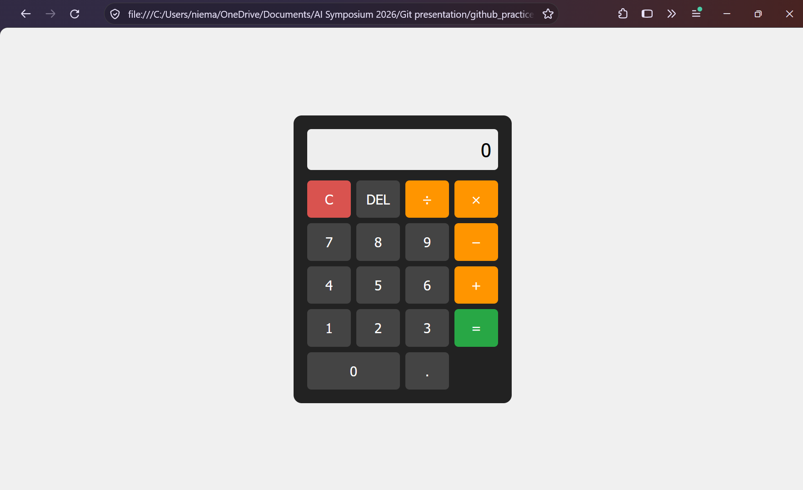

3. commit and push you code:
```bash
git add .github/workflows/CI.yml
git commit -m "CI: trigger workflow on main" # or master
git push origin main # or master
```
4. Confirm that the CI workflow passes.

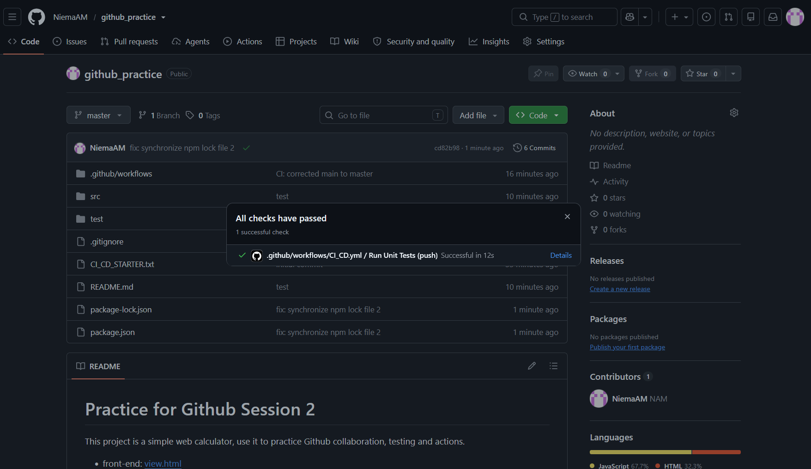 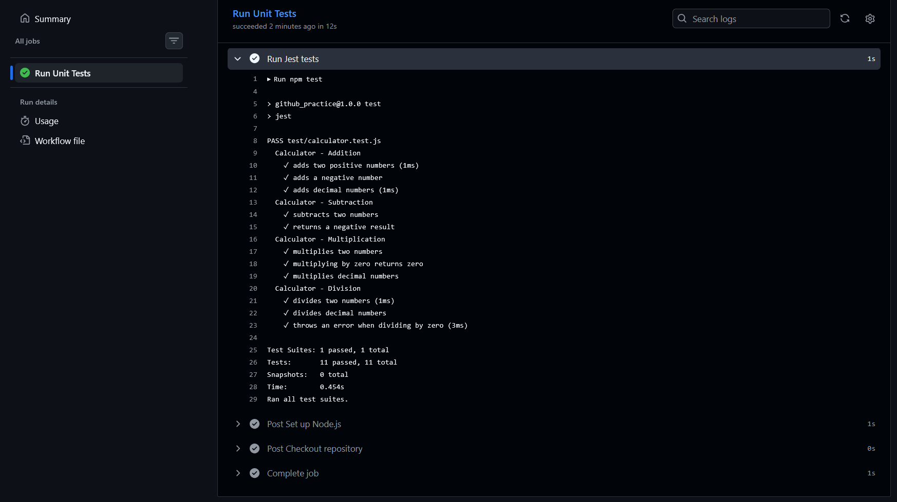

> if the test does not pass try npm upgarde and push again, or verify that your main branch name is correct (can be main or master) 

## Part 4: Continus Deployement
1. create a [CD.yaml](.github/wordkflow/CD.yml) file:
``` text
github_practice/
├── .github/
    └── workflows/
        ├── CI.yml
        └── CD.yml
```
1. in you [CD.yaml](.github/wordkflow/CD.yml) file add at the end of the file:
```yml
name: Calculator CD

on:
  push:
    branches:
      - main # or master

  workflow_dispatch:

permissions:
  contents: read

jobs:
  deploy:
    name: Deploy to GitHub Pages
    runs-on: ubuntu-latest

    permissions:
      contents: read
      pages: write
      id-token: write

    environment:
      name: github-pages
      url: ${{ steps.deployment.outputs.page_url }}

    steps:
      - name: Checkout repository
        uses: actions/checkout@v4

      - name: Configure GitHub Pages
        uses: actions/configure-pages@v5

      - name: Prepare website files
        run: |
          mkdir public
          cp src/view.html public/index.html
          cp src/calculator.js public/calculator.js

      - name: Upload website artifact
        uses: actions/upload-pages-artifact@v3
        with:
          path: public

      - name: Deploy to GitHub Pages
        id: deployment
        uses: actions/deploy-pages@v4
```
2. Enable GitHub Pages in the repository settings.

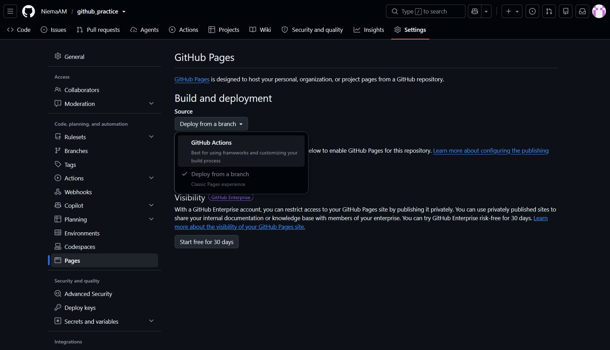

3. commit and push you code
```bash
git add .github/workflows/CD.yml
git commit -m "CD: trigger deployment on main" # or master
git push origin main # or master
```
4. Confirm that the CD workflow passes.

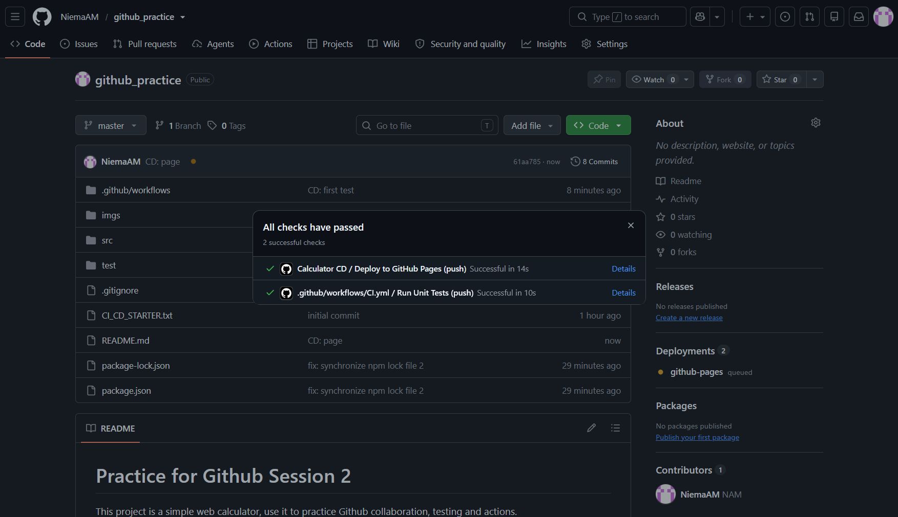 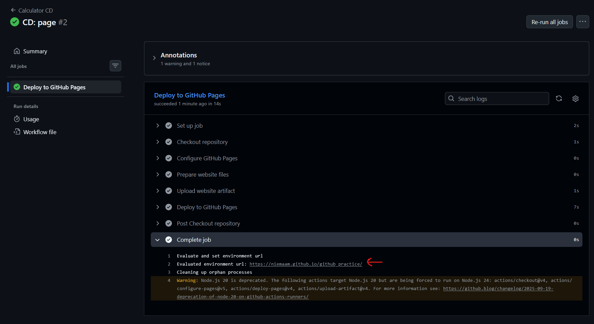

6. Open the published website and test the calculator.

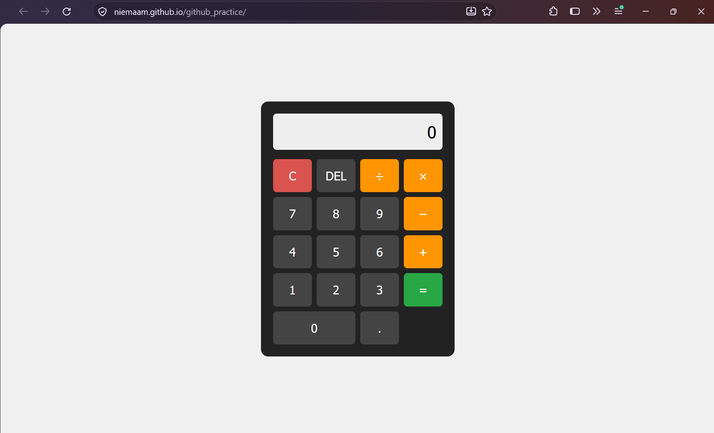
